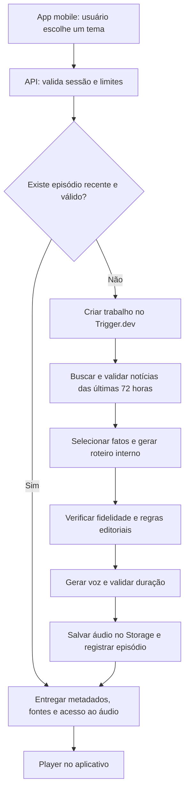

# AXIOM — Roadmap de construção do aplicativo mobile

**Versão:** 1.0  
**Data:** 19 de outubro de 2026  
**Status:** planejamento; desenvolvimento ainda não iniciado.

## 1. Visão do produto

O **AXIOM** será um aplicativo mobile que transforma notícias recentes em podcasts de **2 minutos**, organizados em seis temas fixos. A pessoa escolhe um tema, aguarda a preparação e ouve uma narração clara e natural sobre os principais acontecimentos.

**Proposta de assinatura:** “Entenda o agora em 2 minutos.”

O conteúdo de cada novo episódio será baseado exclusivamente em matérias publicadas nas **últimas 72 horas**. Uma LLM organizará as informações selecionadas e escreverá um roteiro interno; um serviço de síntese de voz transformará esse texto em áudio. O aplicativo exibirá o player e as referências das notícias, sem mostrar o roteiro.

### Decisões já definidas

| Item | Definição |
| --- | --- |
| Nome | **AXIOM**, conforme definido pelo idealizador |
| Produto | Aplicativo mobile de notícias em formato de podcast |
| Conteúdo | Seis temas predefinidos |
| Duração | 2 minutos por episódio, na velocidade normal |
| Atualidade | Notícias publicadas nas últimas 72 horas |
| Roteiro | Interno; indisponível na interface e nas APIs do aplicativo |
| Narração | Voz sintética natural, clara e consistente |

### Premissas recomendadas para a primeira versão

- Android e iOS a partir de uma base de código compartilhada.
- Interface e narração em português brasileiro.
- Público inicial: pessoas que querem acompanhar notícias em pouco tempo.
- Política e Crimes com prioridade para o Brasil; os demais temas terão cobertura internacional quando pertinente.
- Um narrador por episódio e uma voz padrão para o produto.
- Acesso inicial sem cadastro obrigatório, com sessão anônima e controles de uso no servidor.
- Histórico de escuta no aparelho; sincronização entre aparelhos poderá vir depois.
- Monetização será decidida após validar qualidade, uso e custo por episódio.

Essas premissas permitem planejar a construção e poderão ser ajustadas antes da implementação.

## 2. Os seis temas do AXIOM

Os nomes abaixo serão as categorias apresentadas na tela inicial. A delimitação editorial ajuda a diferenciá-las, mesmo quando uma notícia envolve mais de um assunto.

| Tema | O que o episódio deve cobrir | Delimitação editorial | Identificação visual proposta |
| --- | --- | --- | --- |
| **Guerra da Ucrânia** | Acontecimentos do conflito, diplomacia, negociações e impactos humanitários | Foco no conflito e seus efeitos; distinguir declarações das partes e informações confirmadas | Azul `#60A5FA`; ícone de globo |
| **Inteligência Artificial** | Novos modelos, produtos, pesquisas, aplicações e regulação de IA | Evitar notícias genéricas de tecnologia sem relação central com IA | Violeta `#A78BFA`; ícone de circuito |
| **Redes Sociais e Saúde Mental** | Estudos, mudanças nas plataformas e acontecimentos sobre bem-estar digital | Exigir relação com redes sociais e saúde mental; evitar transformar associação em causalidade | Verde `#34D399`; ícone de conversa |
| **Fraudes e Golpes** | Golpes digitais, fraudes financeiras, vazamentos usados em golpes e alertas de prevenção | Priorizar mecanismos de fraude e proteção do público, sem ensinar a executar golpes | Âmbar `#FBBF24`; ícone de escudo |
| **Política** | Governo, Congresso, eleições, políticas públicas e relações institucionais | Foco inicial no Brasil, com atribuição das falas e separação entre fato e opinião | Ciano `#22D3EE`; ícone de instituição |
| **Crimes** | Investigações, segurança pública e desdobramentos de casos criminais | Priorizar casos fora de fraudes e golpes; distinguir suspeita, acusação e condenação | Coral `#FB7185`; ícone de lupa |

**Regra para sobreposição:** cada matéria terá um tema principal e poderá receber etiquetas secundárias internas. Notícias sobre golpes entrarão prioritariamente em Fraudes e Golpes. Um episódio não repetirá o mesmo acontecimento como se fossem notícias diferentes.

## 3. Identidade e temas visuais

**Direção proposta:** visual sóbrio, contemporâneo e editorial, com o áudio como elemento central. O nome AXIOM aparecerá em caixa alta, acompanhado por um símbolo simples que combine a letra “A” com uma onda sonora.

### Tema escuro — padrão recomendado

| Elemento | Cor proposta |
| --- | --- |
| Fundo | `#0B1020` |
| Cartões e superfícies | `#151D30` |
| Texto principal | `#F8FAFC` |
| Texto secundário | `#CBD5E1` |
| Ação principal | `#67E8F9`, com texto escuro |

### Tema claro — alternativa

| Elemento | Cor proposta |
| --- | --- |
| Fundo | `#F8FAFC` |
| Cartões e superfícies | `#FFFFFF` |
| Texto principal | `#0F172A` |
| Texto secundário | `#475569` |
| Ação principal | `#0E7490`, com texto claro |

O aplicativo deverá permitir escolher claro, escuro ou acompanhar o sistema. As cores dos temas serão usadas em detalhes e ícones; os nomes continuarão visíveis. O protótipo deverá validar contraste, ampliação de fonte e áreas de toque. A tipografia poderá usar as fontes nativas de cada plataforma para simplificar a implementação.

## 4. Experiência do usuário e escopo do MVP

**MVP** é a primeira versão funcional, suficiente para validar a proposta com usuários reais.

### Jornada principal

1. A pessoa abre o AXIOM e encontra os seis temas.
2. Toca em um tema para solicitar seu podcast de 2 minutos.
3. O aplicativo mostra o andamento: buscando notícias, preparando o resumo e gerando o áudio.
4. Quando o episódio fica pronto, apresenta o player e o botão de reprodução. O áudio começa após uma ação explícita da pessoa.
5. A pessoa pode pausar, avançar ou voltar 15 segundos e continuar ouvindo com a tela bloqueada.
6. Pode abrir “Fontes deste episódio” para consultar veículos, títulos, datas e links.
7. O episódio entra no histórico local, com o ponto em que a reprodução parou.

### Telas previstas

| Tela | Conteúdo principal |
| --- | --- |
| Início | Marca AXIOM, proposta do produto e seis cartões de temas |
| Preparação | Etapa atual, indicação de espera e tratamento de falhas |
| Player | Tema, título, data de geração, duração real, progresso e controles |
| Fontes | Referências utilizadas e acesso às matérias originais |
| Histórico | Episódios ouvidos, data e opção de continuar a escuta |
| Preferências | Tema visual, informações sobre IA e opções de privacidade |

### Incluído na primeira versão

- [ ] Seis temas fixos e geração a partir da escolha de um deles.
- [ ] Episódios de 2 minutos com narração em português brasileiro.
- [ ] Reprodução em segundo plano e controles na tela bloqueada.
- [ ] Retomada da reprodução e histórico local.
- [ ] Referências das matérias e identificação de conteúdo gerado por IA.
- [ ] Estados de carregamento, falha, falta de conexão e ausência de notícias suficientes.
- [ ] Roteiro protegido no servidor.
- [ ] Reaproveitamento controlado de episódios recentes para reduzir espera e custo.

### Evoluções posteriores

Conta com sincronização, favoritos, downloads para ouvir offline, notificações, escolha de voz, temas personalizados, múltiplos narradores, assinaturas e compartilhamento de episódios.

## 5. Tecnologias recomendadas

A recomendação prioriza ferramentas consolidadas para mobile e serviços gerenciados que reduzam o trabalho de infraestrutura. “Melhor” aqui significa adequação ao AXIOM, facilidade de manutenção e capacidade de crescer; popularidade isolada não resolve essas necessidades.

| Camada | Escolha recomendada | Papel no AXIOM |
| --- | --- | --- |
| Aplicativo | **React Native + Expo + TypeScript** | Construir Android e iOS com uma base compartilhada |
| Navegação e visual | **Expo Router + componentes nativos + StyleSheet** | Organizar telas e manter um sistema visual simples |
| Player | **expo-audio** | Reproduzir episódios e integrar áudio em segundo plano e tela bloqueada |
| API do back-end | **Supabase Edge Functions, em TypeScript** | Validar sessões, aplicar limites e iniciar ou consultar gerações |
| Banco de dados | **PostgreSQL no Supabase** | Guardar temas, episódios, referências e estado dos trabalhos |
| Sessões e arquivos | **Supabase Auth + Storage** | Sessões anônimas e armazenamento protegido dos áudios |
| Processamento em segundo plano | **Trigger.dev, com tarefas Node.js/TypeScript** | Executar busca, roteiro, voz e validações com controle de tentativas |
| Notícias | **GNews API em plano pago**, condicionada à validação de cobertura e permissões | Encontrar matérias recentes e obter conteúdo suficiente para o resumo |
| LLM | **OpenAI Responses API; GPT-5.4 mini como candidato inicial** | Extrair fatos e gerar o roteiro em estrutura validável |
| Voz | **ElevenLabs; Multilingual v2 como candidato inicial** | Narrar em português brasileiro com consistência |
| Tratamento do áudio | **FFmpeg e FFprobe no processamento em segundo plano** | Medir duração, ajustar volume e preparar o arquivo final |
| Builds e distribuição | **Expo EAS Build e EAS Submit** | Gerar e enviar versões Android e iOS |
| Código e automação | **GitHub + GitHub Actions** | Versionamento e verificações antes das entregas |

O [expo-audio documenta reprodução em segundo plano e controles na tela bloqueada](https://docs.expo.dev/versions/latest/sdk/audio/). Essas funções exigem configuração nativa e testes em aparelhos; o [EAS Build permite compilar Android e iOS na nuvem](https://docs.expo.dev/build/), inclusive a partir de um ambiente de desenvolvimento Windows.

As [Edge Functions do Supabase](https://supabase.com/docs/guides/functions) atenderão requisições curtas. A geração completa ficará no [Trigger.dev](https://trigger.dev/docs/introduction), que possui [integração com FFmpeg](https://trigger.dev/docs/config/extensions/ffmpeg). Essa divisão evita depender dos limites de execução de uma única requisição HTTP.

O [GPT-5.4 mini](https://developers.openai.com/api/docs/models/gpt-5.4-mini) será avaliado com [saídas estruturadas](https://developers.openai.com/api/docs/guides/structured-outputs?api-mode=responses). O modelo e sua versão serão fixados após medir fidelidade, tempo e custo em exemplos dos seis temas. Uma resposta no formato correto ainda pode conter erros factuais e precisa passar pelas verificações editoriais.

O [Multilingual v2 da ElevenLabs](https://elevenlabs.io/docs/overview/models) oferece suporte a português do Brasil e é uma opção para narração consistente. A escolha da voz dependerá de teste de escuta; não será tratada como aprovada apenas pela documentação. Usar uma voz com licença adequada ao produto.

### Escolha da fonte de notícias

O [GNews informa que seus planos pagos oferecem notícias em tempo real e conteúdo completo](https://gnews.io/pricing). A primeira etapa avaliará a cobertura real dos seis temas, especialmente Redes Sociais e Saúde Mental, além da qualidade das datas e da independência das fontes.

Há uma dependência a resolver antes da publicação: os [termos do GNews distinguem a assinatura da API dos direitos sobre conteúdo de terceiros](https://gnews.io/legal/terms-of-service). Confirmar as permissões necessárias para processar, resumir, narrar e reter conteúdo. Se não atenderem ao produto, selecionar um fornecedor ou fontes com autorização adequada.

A NewsAPI poderá ser comparada na avaliação, mas não será a escolha inicial: seu [endpoint Everything limita o campo de conteúdo a 200 caracteres](https://newsapi.org/docs/endpoints/everything), e seu [plano gratuito é restrito a desenvolvimento](https://newsapi.org/pricing). Não elaborar episódios apenas a partir de manchetes e trechos insuficientes.

## 6. Arquitetura do sistema

O back-end responderá rapidamente com o identificador do episódio ou do trabalho em andamento. O aplicativo consultará o progresso, sem manter uma conexão HTTP aberta durante toda a geração. Se for fechado, o processamento continuará no servidor; ao reabrir, o app poderá recuperar o estado.

### Dados mínimos previstos

| Registro | Finalidade |
| --- | --- |
| `topics` | As seis categorias, filtros e regras editoriais |
| `articles` | Referências e metadados das matérias; conteúdo conforme permissão e retenção definida |
| `episodes` | Tema, título, estado, duração, geração, validade e localização do áudio |
| `episode_sources` | Relação entre o episódio e as fontes utilizadas |
| `generation_jobs` | Etapas, tentativas, falhas e consumo estimado |
| `episode_scripts` | Roteiro, versão e vínculos entre afirmações e evidências; acesso exclusivo do servidor |

O histórico local conterá somente identificadores, metadados e progresso da escuta. Credenciais de notícias, LLM, voz e serviços administrativos ficarão no servidor. O cliente terá acesso apenas aos dados e arquivos necessários à reprodução, com políticas de acesso e URLs de áudio temporárias.

## 7. Pipeline de notícias, algoritmo e roteiro

### 7.1. Aplicar a janela de 72 horas

- Usar o relógio do servidor e armazenar datas em UTC.
- Aceitar somente matérias cuja publicação esteja entre o momento de referência menos 72 horas e o próprio momento de referência.
- Rejeitar datas futuras, ausentes ou cuja confiabilidade não possa ser estabelecida.
- Uma simples atualização de página não renovará a data de uma notícia antiga. Um novo desdobramento precisará de matéria e evidência identificáveis.
- Revalidar a janela antes de liberar o episódio, inclusive quando houve espera na fila.
- Contextualizar fatos antigos apenas quando necessários para explicar uma matéria recente, deixando clara a diferença temporal.

### 7.2. Buscar, limpar e agrupar

1. Buscar matérias usando palavras-chave e sinônimos de cada tema, inicialmente em português e inglês quando necessário.
2. Consultar um conjunto limitado de resultados — ponto de partida: 20 a 50 matérias por geração, respeitando paginação e quotas.
3. Excluir resultados fora do tema, sem conteúdo suficiente ou fora da janela.
4. Remover duplicatas por URL normalizada e similaridade de conteúdo.
5. Agrupar matérias sobre o mesmo acontecimento e identificar republicações da mesma agência, que não contam como confirmações independentes.

Textos recebidos serão tratados como dados externos. Instruções eventualmente presentes nas páginas não poderão alterar as regras da geração nem acionar ferramentas.

### 7.3. Selecionar os acontecimentos

O algoritmo combinará filtros determinísticos com classificação da LLM. Como ponto de partida, a pontuação considerará relevância para o tema, atualidade, qualidade editorial da fonte e novidade do acontecimento. Os pesos serão calibrados com exemplos reais.

Selecionar **2 a 3 acontecimentos principais**, usando normalmente **3 a 6 matérias** de suporte. Exigir pelo menos duas fontes editoriais independentes no conjunto do episódio. Buscar confirmação independente das afirmações centrais; informação sustentada apenas por uma declaração deverá ser atribuída explicitamente e ter sua incerteza preservada.

Uma pauta com menos acontecimentos poderá aprofundar o contexto se houver material suficiente. Quando não houver base confiável para dois minutos, retornar “Não encontramos notícias recentes suficientes para este tema”. A janela não será ampliada automaticamente.

### 7.4. Extrair fatos e escrever o roteiro

A LLM receberá os conteúdos selecionados e retornará uma estrutura interna com título, fatos, referências por afirmação e texto de narração. Cada afirmação verificável deverá apontar para a matéria que a sustenta.

**Estrutura sugerida para os dois minutos:**

| Trecho | Tempo aproximado | Função |
| --- | --- | --- |
| Abertura | 0–8 segundos | Apresentar o tema e situar a edição |
| Notícias principais | 8–100 segundos | Explicar os acontecimentos com atribuição das informações |
| Contexto | 100–114 segundos | Mostrar consequências sustentadas pelas fontes |
| Encerramento | 114–120 segundos | Concluir e indicar que as fontes estão disponíveis no app |

Começar com aproximadamente **250 a 290 palavras**, ajustadas à voz escolhida. Essa faixa é uma estimativa de produção; a duração será medida no áudio real.

O texto deverá ter frases curtas, transições naturais, siglas explicadas e números preparados para leitura. Usar datas claras quando “hoje” ou “ontem” puderem causar confusão em um episódio reutilizado.

### 7.5. Verificar antes de narrar

- Conferir nomes, números, datas e correspondência com as referências.
- Bloquear afirmações sem suporte e contradições não resolvidas.
- Preservar incertezas, atribuições e divergências entre fontes.
- Revisar tom e linguagem para cada categoria.
- Aplicar amostragem e revisão humana durante o beta; os controles automáticos não garantem ausência de erros.

Em Política e Guerra da Ucrânia, separar declarações de fatos confirmados. Em Crimes, distinguir investigação, suspeita e condenação, evitando detalhes gráficos e exposição desnecessária de vítimas. Em Redes Sociais e Saúde Mental, explicar os limites dos estudos sem produzir diagnóstico individual.

O roteiro ficará em armazenamento privado, sem endpoint de leitura para o aplicativo e sem inclusão em logs acessíveis ao cliente. “Interno” significa que ele não será exibido ao usuário; seu processamento pelas APIs contratadas faz parte da arquitetura.

## 8. Voz e controle dos dois minutos

**Perfil recomendado:** português brasileiro, dicção clara, ritmo confortável e tom jornalístico calmo. Testar pronúncia de nomes brasileiros e ucranianos, siglas, datas e valores.

1. Selecionar a voz com testes de escuta de pessoas do público-alvo.
2. Gerar a narração a partir do roteiro aprovado.
3. Medir a duração com FFprobe e verificar áudio ausente, silêncio excessivo e falhas de geração.
4. Se a duração se afastar da meta, ajustar o roteiro e sintetizar novamente, com limite de duas correções automáticas.
5. Usar somente pequenos ajustes de ritmo e pausas, preservando clareza e frases completas.
6. Preparar o arquivo final para **120 segundos**, com tolerância técnica proposta de **1 segundo** na medição do arquivo.
7. Padronizar volume e salvar em formato compatível com Android e iOS, inicialmente MP3.

Não cortar uma frase nem inserir longos silêncios para atingir a duração. Se o episódio falhar após as correções, não liberá-lo como pronto. A meta considera reprodução em velocidade 1×.

O MVP terá narração sem trilha musical para facilitar a compreensão e o controle de duração. Uma assinatura sonora curta poderá ser avaliada posteriormente.

## 9. Reuso, custo e recuperação de falhas

Como o conteúdo inicial depende do tema e não do perfil da pessoa, vários usuários poderão ouvir o mesmo episódio válido. **A geração será sob demanda, com reuso por tema**, sem exigir um novo gasto de LLM e voz a cada toque.

- Validade inicial proposta do episódio: até **1 hora**, sempre limitada pela janela de 72 horas de todas as matérias utilizadas.
- Antes de reutilizar, verificar se cada fonte continua dentro da janela em relação ao novo pedido. A validade termina quando a primeira matéria ultrapassa esse limite.
- Pedidos simultâneos para o mesmo tema e edição compartilharão o trabalho em andamento.
- Usar uma chave única por edição e controle transacional para evitar gerações duplicadas.
- Invalidar episódios que precisem de correção e impedir novas reproduções pela aplicação após a retirada.
- Episódios anteriores poderão aparecer no histórico com sua data original, identificados como arquivo, sem serem oferecidos como uma atualização recente.

Aplicar limites por sessão e sinais adicionais de abuso, controle global de concorrência e teto de gasto. Uma sessão anônima, sozinha, não é suficiente para limitar consumo abusivo.

| Situação | Comportamento esperado |
| --- | --- |
| Notícias insuficientes | Informar indisponibilidade de conteúdo recente, sem inventar pauta |
| Falha temporária de fornecedor | Repetir apenas a etapa necessária, com espera progressiva e limite de tentativas |
| Quota ou orçamento esgotado | Pausar novas gerações e informar indisponibilidade temporária |
| App fechado durante a geração | Continuar o trabalho no servidor e recuperar o estado depois |
| Conexão interrompida na escuta | Preservar progresso e permitir nova tentativa |
| Episódio corrigido ou retirado | Impedir novo acesso e mostrar sua indisponibilidade no histórico |

## 10. Etapas de construção e entregáveis

**Estimativa inicial:** aproximadamente **6 a 8 semanas de trabalho**, considerando uma pessoa desenvolvedora experiente, dedicação integral e o escopo acima. Prazos de contratação de conteúdo, acesso a contas e revisão das lojas ficam fora dessa estimativa. As etapas são sequenciais, com refinamentos ao longo do trabalho.

| Etapa | Estimativa | Trabalho previsto | Critério de conclusão |
| --- | --- | --- | --- |
| **1. Validar notícias, IA e voz** | 3–5 dias úteis | Testar cobertura dos seis temas, datas, conteúdo, permissões, fidelidade do roteiro e vozes em português | Uma amostra completa de busca até áudio; fornecedor viável e limitações registradas |
| **2. Definir UX e identidade** | 2–3 dias úteis | Refinar marca, claro/escuro, navegação e estados das telas | Protótipo navegável com a jornada principal e estados de erro |
| **3. Preparar a base técnica** | 3–4 dias úteis | Estruturar app, banco, sessões, Storage, tarefas e ambientes separados | App comunica com API; acesso a dados validado e segredos protegidos |
| **4. Construir a coleta e seleção** | 4–5 dias úteis | Implementar janela de 72 horas, filtros, deduplicação, agrupamento e fontes | Conjunto auditável de matérias válidas para cada tema |
| **5. Construir o roteiro e revisão** | 4–5 dias úteis | Extrair fatos, escrever, vincular evidências e bloquear inconsistências | Roteiros avaliados nos seis temas; casos sem suporte são rejeitados |
| **6. Construir a geração de áudio** | 4–5 dias úteis | Integrar voz, duração, volume, armazenamento, reuso e tentativas | Áudios claros de 120 segundos, dentro da tolerância e com falhas tratadas |
| **7. Integrar a experiência mobile** | 4–6 dias úteis | Finalizar telas, progresso, player, fontes, histórico e preferências | Jornada completa funcionando em Android e iPhone físicos |
| **8. Testar e preparar o lançamento** | 5–7 dias úteis | Beta, correções, métricas, controles de consumo e materiais de loja | Versão candidata aprovada nos critérios abaixo e pronta para submissão |

### Marcos de acompanhamento

- [ ] **Marco 1 — Viabilidade:** notícias, direitos de uso, roteiro e voz atendem à proposta.
- [ ] **Marco 2 — Fluxo completo:** escolher um tema resulta em um episódio reproduzível.
- [ ] **Marco 3 — Beta:** os seis temas funcionam nos dois sistemas, com métricas e controle de custo.
- [ ] **Marco 4 — Versão candidata:** critérios de qualidade cumpridos e materiais de publicação preparados.

## 11. Verificação e critérios de aceite

### Conteúdo e atualidade

- [ ] Todos os seis temas têm busca e regras editoriais próprias.
- [ ] Toda matéria utilizada em uma nova edição tem data verificável dentro das últimas 72 horas.
- [ ] Há testes para os limites exatos da janela, fusos, datas futuras e expiração durante fila ou reuso.
- [ ] Republicações da mesma origem não contam como fontes independentes.
- [ ] Episódios sem material suficiente não são gerados.
- [ ] Cada afirmação verificável do roteiro possui referência interna.
- [ ] As fontes utilizadas podem ser consultadas pelo usuário.
- [ ] Uma amostra de pelo menos cinco episódios por tema passa por revisão humana no beta, sem erros factuais críticos pendentes.

### Áudio e experiência mobile

- [ ] Arquivo final tem 120 segundos, com tolerância de 1 segundo.
- [ ] Narração recebe avaliação média de pelo menos 4/5 em clareza e naturalidade no teste inicial com ouvintes.
- [ ] Reprodução, pausa, busca e retomada funcionam em aparelhos Android e iOS físicos.
- [ ] Áudio funciona em segundo plano, com tela bloqueada, fones Bluetooth e interrupções de chamadas.
- [ ] Interface respeita tema do sistema, ampliação de fonte e leitores de tela nos controles essenciais.
- [ ] Estados de conexão ruim, falha e ausência de notícias são compreensíveis.

### Operação e proteção de dados

- [ ] Roteiros e credenciais não aparecem no pacote do app, respostas da API ou registros expostos.
- [ ] Políticas de banco e Storage impedem acesso indevido a roteiros e trabalhos de outras sessões.
- [ ] Pedidos concorrentes não geram episódios duplicados para a mesma edição.
- [ ] Falhas, novas tentativas e encerramento do app não deixam trabalhos indefinidamente em processamento.
- [ ] Consumo por etapa, tempo de geração e custos ficam registrados para acompanhamento.
- [ ] Há procedimento para retirar ou corrigir episódios e prazos definidos para retenção de textos, áudios e histórico.

## 12. Métricas e planejamento de custos

| Métrica | Para que acompanhar |
| --- | --- |
| Tempo até o áudio ficar pronto | Reduzir a espera; separar episódios reutilizados de novas gerações |
| Taxa de conclusão da geração | Encontrar falhas em notícias, LLM, voz ou processamento |
| Falta de notícias por tema | Ajustar fontes e consultas sem afrouxar a janela |
| Taxa de conclusão da escuta | Avaliar interesse e qualidade dos episódios |
| Avaliação de voz e conteúdo | Medir clareza, confiança e relevância |
| Custo por episódio novo e por escuta | Verificar sustentabilidade e efeito do reuso |
| Episódios retirados ou corrigidos | Acompanhar qualidade editorial |

**Estrutura de custo mensal:** serviços de infraestrutura + fornecedor de notícias + uso de LLM + síntese de voz + armazenamento e transferência de áudio + builds e contas de distribuição, quando aplicáveis.

Na etapa 1, medir tokens, caracteres narrados, duração do processamento, volume dos arquivos e novas tentativas. Usar essas medidas para projetar cenários de 100, 1.000 e 10.000 escutas por dia, explicitando quantas gerações novas cada cenário exige. O número de escutas e o número de episódios gerados não são equivalentes.

Os valores finais dependerão do plano contratado, cobertura de conteúdo, volume de uso e taxa de reuso. Estabelecer orçamento e alertas antes do beta; o roadmap não pressupõe operação gratuita.

## 13. Preparação para publicação

- [ ] Verificar disponibilidade do nome AXIOM nas lojas e na identidade comercial antes de produzir os materiais finais.
- [ ] Definir a licença de uso do conteúdo e da voz, além da política de retenção.
- [ ] Preparar política de privacidade e informações sobre os serviços que processam dados e conteúdo.
- [ ] Identificar claramente a narração e o resumo como gerados por IA.
- [ ] Disponibilizar canal para reportar erro e solicitar correção de episódio.
- [ ] Preparar ícone, capturas de tela, descrição e classificação etária compatível com os assuntos cobertos.
- [ ] Validar os requisitos vigentes de cada loja no momento da submissão.
- [ ] Distribuir beta, corrigir problemas e produzir a versão candidata.

## 14. Ordem recomendada de execução

Começar pela validação de uma edição completa: **notícias recentes → fatos verificáveis → roteiro → voz → áudio de dois minutos**. Após comprovar cobertura, qualidade e custo nos seis temas, avançar para a base técnica e a experiência mobile. O próximo entregável de desenvolvimento será a prova de viabilidade descrita na etapa 1.

Este documento entrega o planejamento solicitado. Não inclui código do aplicativo, criação de serviços externos ou contratação de fornecedores.
